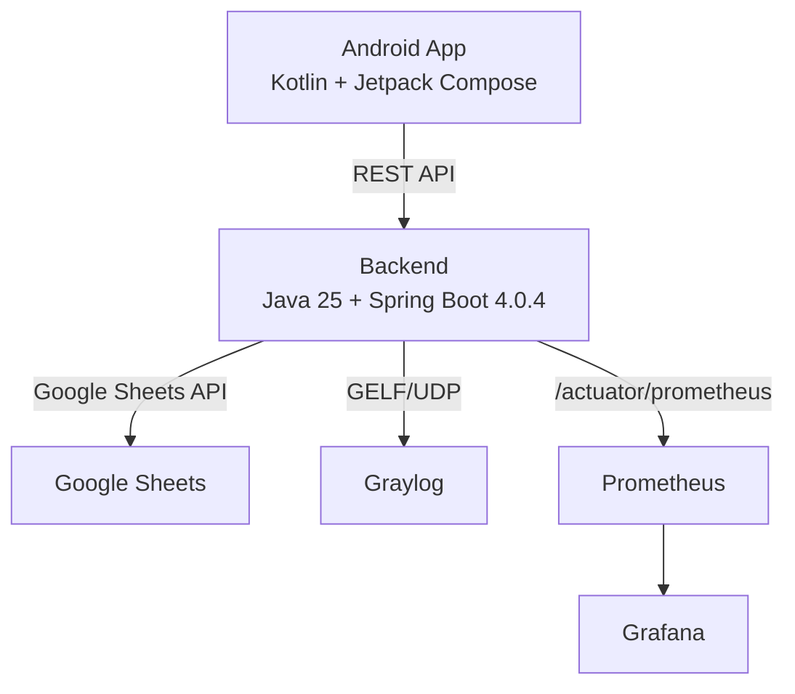
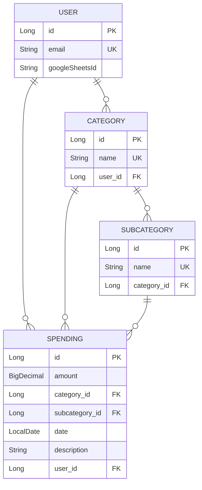

# AGENTS.md — Spending Tracker

Документ для AI-агентов. Здесь описана структура проекта, архитектура и ключевые соглашения.

---

## Описание проекта

**Spending Tracker** — приложение для учёта личных расходов с синхронизацией в Google Sheets.

- **Версия**: v0.0.1
- **Стадия**: MVP1
- **Назначение**: Мобильное приложение (Android) для фиксации расходов по категориям, просмотра сводок и синхронизации данных с облаком через REST API backend.

---

## Архитектура



### Backend (`backend/`)

Java 25 + Spring Boot 4.0.4, REST API, Spring Security, OAuth 2.0, JPA, PostgreSQL + Liquibase, Maven.

**Структура пакетов** (`spending.tracker.backend`):
- `config/` — конфигурация (Security, Web, EmailAuthenticationFilter)
- `controller/` — REST контроллеры (User, Category, SubCategory, Spending, Root)
- `dto/` — Request/Response DTOs
- `entity/` — JPA сущности (User, Category, SubCategory, Spending)
- `exception/` — обработка исключений
  - `handler/GlobalExceptionHandler.java` — единая точка обработки
  - `type/` — типы исключений
- `filter/` — `HttpLoggingFilter` (HTTP-логирование, correlation_id)
- `mapper/` — MapStruct мапперы (User, Category, SubCategory, Spending)
- `model/` — внутренние модели
- `repository/` — Spring Data JPA репозитории
- `service/` — бизнес-логика
  - `data/` — Data Services (доступ к данным)
- `validation/` — валидация email через header (`ValidEmailHeader`, `ValidEmailHeaderArgumentResolver`)

**Аутентификация**: email передаётся в заголовке `X-User-Email`, валидируется через `@ValidEmailHeader`

**API Endpoints** (Swagger: `http://localhost:8081/swagger-ui/index.html`):

| Модуль | Base URL | Описание |
|--------|----------|----------|
| User | `/api/v1/user` | Управление пользователями |
| Category | `/api/v1/categories` | Категории расходов |
| SubCategory | `/api/v1/subcategories` | Подкатегории |
| Spending | `/api/v1/spending` | Расходы |

### Frontend (Android) — отдельный репозиторий

Kotlin + Jetpack Compose + Room (SQLite) + Ktor + Koin

### Инфраструктура

- `docker-compose.yml` — сервисы `app`, `graylog`, `mongo`, `opensearch`, `prometheus`, `grafana`.
- `Dockerfile` — сборка образа приложения (jar).
- `prometheus.yml` — конфигурация сбора метрик (app, postgres/node exporters).
- `.env` — переменные окружения (БД, порты, секреты Graylog).

---

## Модель данных

### Entities



### Категории расходов (по умолчанию)

Продукты, еда, доставки | Авто и транспорт | Кредиты | Я | Услуги | Сигареты | Образование | Вредности | Кафе и рестораны, развлечения | Кошка | Квартира и обязательные платежи | Дом и уют | Работа, корпоративы | Подарки | Подписки | Вклад | Семья | Иное

### Категории доходов (по умолчанию)

Кешбеки | Налоговый вычет | Иные доходы | Зарплата

---

## Технологии

### Backend

| Компонент | Версия / примечание |
|-----------|---------------------|
| Java | 25 |
| Spring Boot | 4.0.4 |
| Lombok | 1.18.44 |
| MapStruct | 1.6.3 |
| SpringDoc OpenAPI | 3.0.3 |
| PostgreSQL | — (продакшн-БД) |
| Liquibase | 5.0.2 |
| H2 Database | — (только тесты) |
| Actuator + Micrometer Prometheus | — |
| logstash-logback-encoder | 9.0 |
| logback-gelf | 6.1.2 |
| google-api-client | 2.9.0 |
| java-dotenv | 5.2.2 |

### Сборка и запуск

```bash
# Сборка
mvn clean install

# Запуск backend
cd backend && mvn spring-boot:run

# Запуск тестов
cd backend && mvn test

# Запуск в Docker
mvn clean package
docker-compose up -d --build
```

---

## Ключевые соглашения

### Паттерн Service Layer

```
Controller -> Service -> DataService -> Repository
                |
                v
             Mapper (MapStruct)
```

1. **Controller** — обработка HTTP, валидация, документация OpenAPI
2. **Service** — бизнес-логика, маппинг DTO -> Model
3. **DataService** — доступ к данным (find/save/update/delete)
4. **Mapper** — преобразование между слоями

### База данных и миграции

- Продакшн-БД — PostgreSQL; параметры подключения берутся из переменных окружения (`DB_HOST`, `DB_PORT`, `DB_NAME`, `DB_USERNAME`, `DB_PASSWORD`).
- Миграции — Liquibase, changelog: `backend/src/main/resources/db/changelog/db.changelog-master.xml` (изменения в `db/changelog/mvp1/`).
- В тестах Liquibase отключён, используется H2 in-memory (`application-test.yml`, `ddl-auto: create-drop`).

### Логирование и мониторинг

- Конфигурация Logback: `backend/src/main/resources/logback-spring.xml`.
- HTTP-логирование — `filter/HttpLoggingFilter`: генерация `correlation_id`, заголовок `X-Correlation-Id`, тела запросов/ответов только на DEBUG (обрезка до 500 символов).
- Логи отправляются в Graylog через GELF/UDP (`logback-gelf`) в структурированном JSON (`logstash-logback-encoder`); sensitive-данные (`authorization`, `password`, `token`, JWT) маскируются энкодером.
- Профили Logback: `default` — console + Graylog; `test` — только console (без Graylog).
- Метрики — Actuator (`/actuator/prometheus`), сбор в Prometheus, визуализация в Grafana.
- Подробности: [`documentation/history/graylog.md`](documentation/history/graylog.md).

### Обработка ошибок

Все исключения обрабатываются в `GlobalExceptionHandler`. Типы исключений в `exception/type/`:

- `ResourceNotFoundException` — ресурс не найден (404)
- `DuplicateEntityException` — дублирование (409)
- `DuplicateCategoryException` / `DuplicateSubCategoryException`
- `CategoryInUseException` / `SubCategoryInUseException` — удаление связанных сущностей
- `ForeignKeyException` — нарушение foreign key
- `InvalidEmailException` — некорректный email

### Тесты

Обязательные правила оформления тестов вынесены в [`.agents/rules/testing_rules.md`](.agents/rules/testing_rules.md). Кратко:

- Модификатор доступа класса указывается явно: `public class LogbackMaskingTest { ... }`, а не `class LogbackMaskingTest { ... }`.
- Первый элемент коллекции берётся через `.getFirst()`, а не `.get(0)` (последний — `.getLast()`).
- Интеграционные тесты наследуются от `BaseSpringBootTest` (профиль `test`, H2 in-memory).
- Тестовые данные создаются через `TestDataUtils`.
- `@DisplayName` — на русском языке.

---

## Планы разработки

| План | Файл | Описание |
|------|------|----------|
| Глобальный | [`documentation/history/global_plan.md`](documentation/history/global_plan.md) | Общий план разработки |
| Android | [`documentation/history/android_kotlin_plan.md`](documentation/history/android_kotlin_plan.md) | Создание Android-приложения |
| Backend MVP | [`documentation/plan/mvp_plan_back.md`](documentation/plan/mvp_plan_back.md) | Планы релизов backend |
| Google Sheets | [`documentation/plan/google_sheets_integration_plan.md`](documentation/plan/google_sheets_integration_plan.md) | Интеграция с Google Sheets |
| Модуль меню | [`.plans/menu_module_plan.md`](.plans/menu_module_plan.md) | План модуля меню |
| Текущие задачи | [`.plans/task.md`](.plans/task.md) | Текущие задачи |

---

## Полезные ссылки

- Swagger UI: `http://localhost:8081/swagger-ui/index.html`
- Actuator health: `http://localhost:8081/actuator/health`
- Prometheus metrics: `http://localhost:8081/actuator/prometheus`
- Graylog UI: `http://localhost:9000`
- Prometheus UI: `http://127.0.0.1:9090`
- Grafana UI: `http://127.0.0.1:3000`
- API спецификация: [`documentation/api_specification.md`](documentation/api_specification.md)
- Правила тестов: [`.agents/rules/testing_rules.md`](.agents/rules/testing_rules.md)