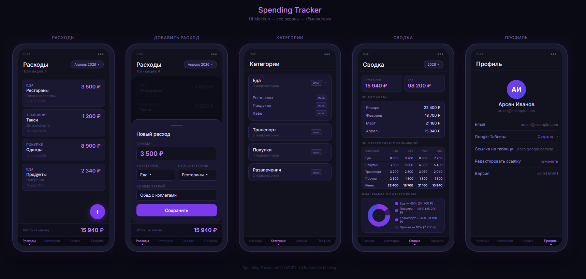
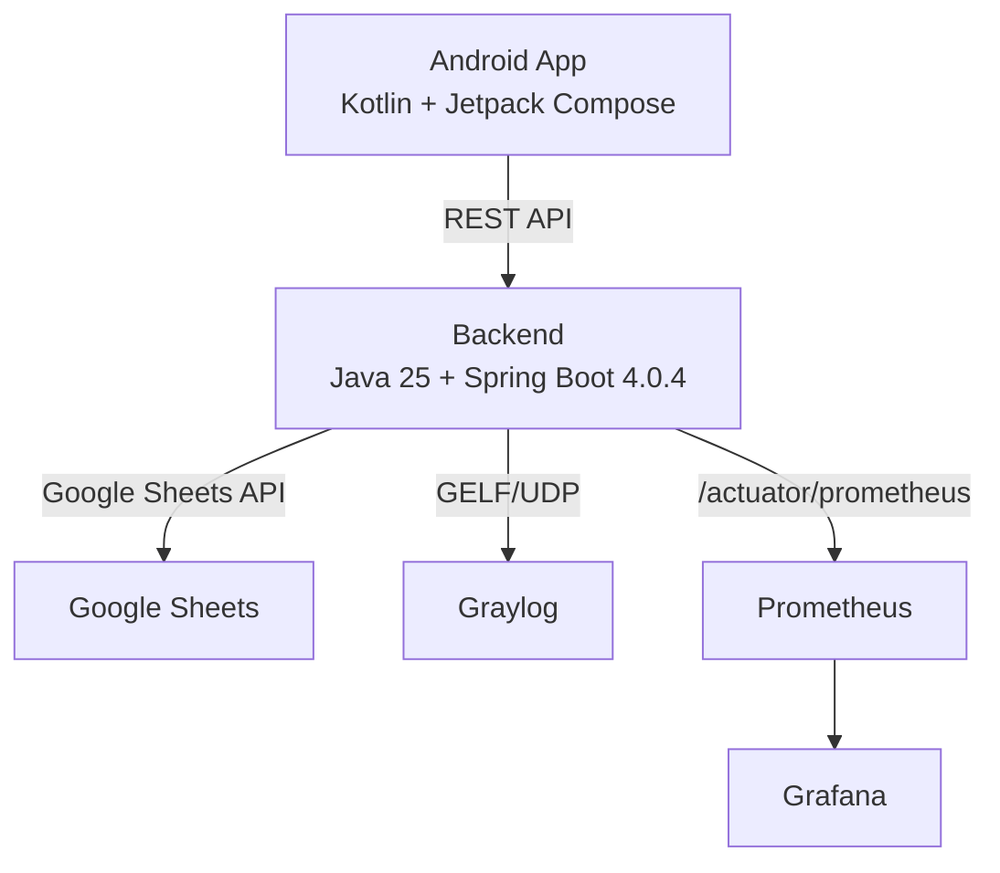

# Spending Tracker

Приложение для учёта личных расходов с синхронизацией в Google Sheets.

**Версия**: v0.0.1 (MVP1) — 01.01.2026



## О проекте

**Spending Tracker** — приложение для фиксации личных расходов по категориям и подкатегориям, просмотра сводок и синхронизации данных с облаком. Backend предоставляет REST API поверх PostgreSQL, данные могут выгружаться в Google Sheets.

- **Backend** (`backend/`) — Java 25 + Spring Boot 4.0.4, REST API, Spring Security, PostgreSQL + Liquibase, логирование в Graylog, метрики Prometheus.
- **Android** (отдельный репозиторий) — Kotlin, Jetpack Compose, Room, Ktor.

## Архитектура



## Модули проекта

| Модуль | Статус | Репозиторий |
|--------|--------|-------------|
| `backend` | ✅ Готов | https://github.com/Terpsihoransk/spending_tracker |
| `android` | ✅ Готов | https://github.com/Terpsihoransk/spending-tracker-android |

## Структура репозитория

```
spending_tracker/
├── backend/                    # Java 25 + Spring Boot 4.0.4 (REST API)
│   └── src/
│       ├── main/java/spending/tracker/backend/
│       │   ├── config/         # Security, Web, EmailAuthenticationFilter
│       │   ├── controller/     # REST контроллеры
│       │   ├── dto/            # Request/Response DTO
│       │   ├── entity/         # JPA сущности
│       │   ├── exception/      # Обработка исключений
│       │   ├── filter/         # HttpLoggingFilter (логирование + correlation_id)
│       │   ├── mapper/         # MapStruct мапперы
│       │   ├── model/          # Внутренние модели
│       │   ├── repository/     # Spring Data JPA репозитории
│       │   ├── service/        # Бизнес-логика + data-сервисы
│       │   └── validation/     # Валидация X-User-Email
│       ├── main/resources/
│       │   ├── application.yml
│       │   ├── logback-spring.xml
│       │   └── db/changelog/   # Liquibase миграции
│       └── test/               # H2, профиль test, TestDataUtils
├── .agents/
│   └── rules/                  # Правила для AI-агентов (testing_rules.md)
├── documentation/              # Спецификация API, планы, история
├── .plans/                     # Текущие планы разработки
├── docker-compose.yml          # app, Graylog, Mongo, OpenSearch, Prometheus, Grafana
├── Dockerfile
├── prometheus.yml              # Конфигурация сбора метрик
└── pom.xml                     # Родительский Maven (модуль backend)
```

## Запуск

### Backend локально

Требуется установленный JDK 25 и PostgreSQL. Параметры подключения задаются переменными окружения:

| Переменная | Описание |
|-----------|----------|
| `DB_HOST`, `DB_PORT`, `DB_NAME` | Подключение к PostgreSQL |
| `DB_USERNAME`, `DB_PASSWORD` | Учётные данные БД |
| `SERVER_PORT`, `SERVER_ADDRESS` | Порт и адрес HTTP-сервера (по умолчанию `8081`) |
| `GRAYLOG_HOST`, `GRAYLOG_PORT` | Отправка логов в Graylog (GELF/UDP) |

```bash
# Сборка
mvn clean install

# Запуск backend
cd backend && mvn spring-boot:run
```

Swagger UI: `http://localhost:8081/swagger-ui/index.html`

### Через Docker Compose

```bash
# Собрать jar
mvn clean package

# Поднять инфраструктуру и приложение
docker-compose up -d --build

# Остановить
docker-compose down
```

`docker-compose.yml` поднимает: `app`, `graylog`, `mongo`, `opensearch`, `prometheus`, `grafana`. Секреты и параметры подключения хранятся в `.env`.

### Тесты

```bash
cd backend && mvn test
```

Тесты используют H2 in-memory и профиль `test`. Обязательные правила оформления тестов — в [`.agents/rules/testing_rules.md`](.agents/rules/testing_rules.md).

## Технологии

| Компонент | Версия / примечание |
|-----------|---------------------|
| Java | 25 |
| Spring Boot | 4.0.4 |
| Spring Security / OAuth2 | — |
| Lombok | 1.18.44 |
| MapStruct | 1.6.3 |
| SpringDoc OpenAPI | 3.0.3 |
| PostgreSQL | продакшн-БД |
| Liquibase | 5.0.2 (миграции) |
| H2 Database | только тесты |
| Actuator + Micrometer Prometheus | метрики |
| logstash-logback-encoder | 9.0 (структурный JSON + маскирование) |
| logback-gelf | 6.1.2 (GELF/UDP транспорт в Graylog) |
| google-api-client | 2.9.0 |
| java-dotenv | 5.2.2 |

## API Спецификация

Полная спецификация REST API (контроллеры, методы, DTO, примеры запросов/ответов) описана в файле [`documentation/api_specification.md`](documentation/api_specification.md).

Краткий обзор эндпоинтов:

| Модуль | Метод | Эндпоинт | Описание |
|--------|-------|----------|----------|
| User | POST | `/api/v1/user` | Создать или получить пользователя по email |
| User | GET | `/api/v1/user` | Получить всех пользователей |
| Category | GET | `/api/v1/categories` | Получить категории пользователя |
| Category | GET | `/api/v1/categories/{id}` | Получить категорию по id |
| Category | POST | `/api/v1/categories` | Создать категорию |
| Category | PUT | `/api/v1/categories/{id}` | Обновить категорию |
| Category | DELETE | `/api/v1/categories/{id}` | Удалить категорию |
| SubCategory | GET | `/api/v1/subcategories?categoryId={id}` | Получить подкатегории категории |
| SubCategory | POST | `/api/v1/subcategories` | Создать подкатегорию |
| SubCategory | PUT | `/api/v1/subcategories/{id}` | Обновить подкатегорию |
| SubCategory | DELETE | `/api/v1/subcategories/{id}` | Удалить подкатегорию |
| Spending | GET | `/api/v1/spending` | Получить расходы |
| Spending | GET | `/api/v1/spending/{id}` | Получить расход по id |
| Spending | POST | `/api/v1/spending` | Создать расход |
| Spending | PUT | `/api/v1/spending/{id}` | Обновить расход |
| Spending | DELETE | `/api/v1/spending/{id}` | Удалить расход |

Все запросы, кроме `POST /api/v1/user`, требуют заголовок `X-User-Email`.
Swagger UI: `http://localhost:8081/swagger-ui/index.html`

## Логирование и мониторинг

- **Graylog** — структурные JSON-логи через GELF/UDP. HTTP-запросы логируются фильтром `HttpLoggingFilter` с `correlation_id` и заголовком `X-Correlation-Id`. Sensitive-данные (`authorization`, `password`, `token`, JWT) маскируются на уровне энкодера. Подробности — [`documentation/history/graylog.md`](documentation/history/graylog.md).
- **Prometheus / Grafana** — метрики доступны по `/actuator/prometheus`, сбор настраивается в [`prometheus.yml`](prometheus.yml).
- **Actuator** — эндпоинты `health`, `info`, `prometheus`, `metrics`.

## Общие коды ошибок

| Код | Описание |
|-----|----------|
| `400` | Bad Request — ошибки валидации входных данных |
| `404` | Not Found — ресурс не найден |
| `409` | Conflict — дублирование имени или нарушение ограничений (категория/подкатегория используется) |

## Документация

| Документ | Описание |
|----------|----------|
| [`AGENTS.md`](AGENTS.md) | Структура проекта, архитектура и соглашения для AI-агентов |
| [`documentation/api_specification.md`](documentation/api_specification.md) | Полная спецификация REST API |
| [`.agents/rules/testing_rules.md`](.agents/rules/testing_rules.md) | Обязательные правила написания тестов |
| [`documentation/history/graylog.md`](documentation/history/graylog.md) | Логирование и интеграция с Graylog |
| [`documentation/history/global_plan.md`](documentation/history/global_plan.md) | Глобальный план разработки |
| [`documentation/plan/mvp_plan_back.md`](documentation/plan/mvp_plan_back.md) | Планы по релизам backend |