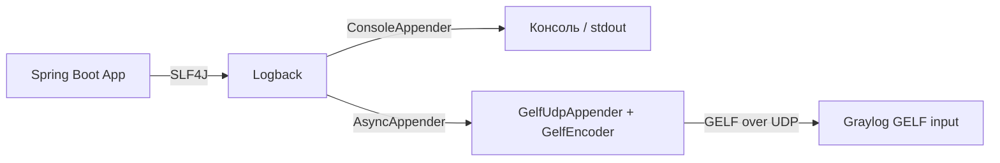

# Логирование и интеграция с Graylog

Документ описывает, как устроено логирование в `spending-tracker-backend`, какой инцидент был с доставкой логов в Graylog и что сделано по итогу.

---

## 1. Как логирование устроено в принципе

### 1.1. Общая схема

Приложение использует **SLF4J + Logback** (поверх `spring-boot-starter-web`), логи доставляются в **Graylog** по **UDP** в формате **GELF** и одновременно (частично) выводятся в консоль.



### 1.2. Конфигурация Logback

Файл: [`backend/src/main/resources/logback-spring.xml`](../../backend/src/main/resources/logback-spring.xml)

- **`CONSOLE`** — `ConsoleAppender` с паттерном `%d{yyyy-MM-dd HH:mm:ss.SSS, Asia/Novosibirsk} [%level] - %msg%n`;
- **`GRAYLOG_UDP`** — `de.siegmar.logbackgelf.GelfUdpAppender`; host/port берутся из `GRAYLOG_HOST` / `GRAYLOG_PORT`, энкодер — `de.siegmar.logbackgelf.GelfEncoder`;
- **`ASYNC_GRAYLOG`** — асинхронная обёртка над `GRAYLOG_UDP` (`queueSize=512`, `discardingThreshold=0`, `neverBlock=true`), чтобы логирование не блокировало request-потоки;
- **профили**:
  - `default` — консоль + Graylog, прикладные логгеры приглушены (`org.hibernate`, `com.zaxxer.hikari`, `org.springframework.web` и т.д. — уровень `WARN`);
  - `test` — **только консоль**, без Graylog.

Уровни логгеров заданы явно и сохраняются как контракт.

### 1.3. HTTP-логирование

Класс: [`backend/src/main/java/spending/tracker/backend/filter/HttpLoggingFilter.java`](../../backend/src/main/java/spending/tracker/backend/filter/HttpLoggingFilter.java)

Фильтр на каждый HTTP-запрос:

1. генерирует `correlation_id` (UUID) и кладёт его в **MDC**;
2. добавляет в ответ заголовок **`X-Correlation-Id`** с тем же значением;
3. оборачивает запрос в `ContentCachingRequestWrapper` (лимит кеша `CACHE_LIMIT = 10000`) и ответ в `ContentCachingResponseWrapper`;
4. после обработки логирует запрос/ответ;
5. в `finally` возвращает тело клиенту (`copyBodyToResponse()`) и очищает MDC (`MDC.clear()`).

Логирование HTTP идёт через отдельный логгер с именем **`HTTP`** (пишет и в консоль, и в Graylog).

### 1.4. Формат сообщений в Graylog

Graylog принимает логи через **GELF-инпут**, поэтому сообщение обязано быть валидным GELF (`version`, `host`, `short_message`; все прочие поля — дополнительные, с префиксом `_`). В Graylog дополнительные поля хранятся **без** ведущего подчёркивания.

---

## 2. Инцидент: логи перестали доходить до Graylog

### 2.1. Симптом

После перевода энкодера на `net.logstash.logback.encoder.LoggingEventCompositeJsonEncoder` приложение больше не писало в Graylog (локально в консоли логи были, а в Graylog — ничего).

### 2.2. Первопричина

`LoggingEventCompositeJsonEncoder` формирует **logstash-JSON**, а не **GELF**. GELF-инпут Graylog требует обязательные поля `version`, `host`, `short_message`, а все дополнительные поля — с префиксом `_`. Сообщения logstash-JSON не проходят парсер GELF и отбрасываются на инпуте. Раньше работало, потому что использовался `GelfEncoder`, который формирует корректный GELF.

### 2.3. Решение

Graylog-энкодер возвращён на **`de.siegmar.logbackgelf.GelfEncoder`** (валидный GELF), при этом структурированность сохранена за счёт **MDC**:

```xml
<appender name="GRAYLOG_UDP" class="de.siegmar.logbackgelf.GelfUdpAppender">
    <graylogHost>${GRAYLOG_HOST}</graylogHost>
    <graylogPort>${GRAYLOG_PORT}</graylogPort>
    <encoder class="de.siegmar.logbackgelf.GelfEncoder">
        <includeMdcData>true</includeMdcData>
        <includeLevelName>true</includeLevelName>
        <loggerNameKey>logger_name</loggerNameKey>
        <threadNameKey>thread_name</threadNameKey>
        <staticField>app_name:${appName}</staticField>
        <staticField>environment:production</staticField>
        <staticField>timezone:Asia/Novosibirsk</staticField>
    </encoder>
</appender>
```

`GelfEncoder` кладёт записи MDC в дополнительные GELF-поля (с префиксом `_`), поэтому в Graylog они становятся отдельными полями, пригодными для фильтрации:
`correlation_id`, `http.method`, `http.uri`, `http.query`, `http.status`, `http.duration_ms`, `http.user_agent`, `http.content_type`, `http.x_requested_with`, `http.request_body`, `http.response_body`.

---

## 3. Что сделано в рамках рефакторинга

### 3.1. До рефакторинга

- HTTP-лог формировался вручную: `String.format("http_request|method=...|uri=...|...")` — единая неструктурированная строка, по которой нельзя фильтровать в Graylog.
- Маскирование `authorization` реализовано точечно внутри фильтра.
- Тела запросов/ответов логировались на уровне **INFO** — риск утечки PII/токенов.

### 3.2. Итоговая конфигурация Graylog-энкодера

Энкодер — `GelfEncoder` (см. 2.3). Транспорт `GelfUdpAppender`, `AsyncAppender`, консоль и профили не менялись по существу.

### 3.3. Поля в Graylog

| Поле в Graylog | Источник |
|----------------|----------|
| `message` | `short_message` (GELF) |
| `full_message` | сообщение + stack trace |
| `timestamp` | GELF timestamp (epoch) |
| `level` | числовой GELF-уровень |
| `level_name` | `includeLevelName` |
| `logger_name`, `thread_name` | ключи энкодера |
| `correlation_id` | MDC |
| `http.*` | MDC (поля HTTP-запроса) |
| `app_name`, `environment`, `timezone` | `staticField` |

### 3.4. Рефакторинг `HttpLoggingFilter`

- убраны `String.format` и ручная склейка `key=value`;
- данные раскладываются по отдельным полям через `MDC` с префиксами `http.*`;
- заголовки логируются отдельными полями (`http.user_agent`, `http.content_type`, `http.x_requested_with`);
- **`authorization` в фильтре не логируется вообще**;
- **тела запроса и ответа логируются на уровне INFO** (и в структурированные поля MDC, и в само сообщение — чтобы быть видимыми в консоли) с **маскированием sensitive-данных** и обрезкой до 500 символов (суффикс `... [truncated]`);
- маскируются: значения JSON-полей и form-параметров, имя которых содержит `password`, `passwd`, `pwd`, `token`, `secret`, `authorization`, `cookie`, `email` (например `password`, `userEmail`) → `***`; токены вида `Bearer <token>`, JWT-подобные строки и email-адреса (regex `...@...`) → `***`;
- тела `multipart/form-data` и бинарных content-type (`image/*`, `audio/*`, `video/*`, `application/octet-stream`, `application/pdf`, `application/zip`, `application/gzip`, `application/x-protobuf`) не логируются — вместо тела пишется `<not logged>`;
- сохранено: генерация `correlation_id`, заголовок `X-Correlation-Id`, `CACHE_LIMIT = 10000`, `copyBodyToResponse()` в `finally`, `MDC.clear()` в `finally`.

### 3.5. Маскирование sensitive-данных

`MaskingJsonGeneratorDecorator` работает только с logstash-энкодером, который **несовместим с GELF-инпутом Graylog**. Поэтому маскирование выполняется прямо в фильтре (`maskSensitive`), до записи в лог:

- заголовок `authorization` не логируется вовсе;
- в телах запроса/ответа значения sensitive-полей и токены заменяются на `***`;
- в [`GlobalExceptionHandler`](../../backend/src/main/java/spending/tracker/backend/exception/handler/GlobalExceptionHandler.java) все сообщения (`ex.getMessage()`) и `X-User-Email` перед логированием прогоняются через `LogSanitizer.mask(...)`, поэтому email/токены не утекают в текст WARN/ERROR;
- проверено, что в остальных местах логирования ([`EmailAuthenticationFilter`](../../backend/src/main/java/spending/tracker/backend/config/EmailAuthenticationFilter.java)) нет `password`, `token`, `authorization`, `cookie`, `secret`.

В результате sensitive-данные не попадают ни в консоль, ни в Graylog.

### 3.6. Зависимости

- `logback-gelf` — используется (UDP-транспорт + `GelfEncoder`).
- `logstash-logback-encoder` — после отказа от logstash-формата **больше не используется**; зависимость можно удалить из [`backend/pom.xml`](../../backend/pom.xml) (не удалена, чтобы не расширять scope).
- Версии Spring Boot и Java не менялись.

### 3.7. Тесты

- [`GelfEncodingTest`](../../backend/src/test/java/spending/tracker/backend/filter/GelfEncodingTest.java): загружает GELF-конфигурацию ([`logback-gelf-verify.xml`](../../backend/src/test/resources/logback-gelf-verify.xml)), проверяет валидный GELF-конверт (`version`/`host`/`short_message`) и наличие структурированных полей (`_correlation_id`, `_http.method`, статические `_environment`/`_timezone`), а также отсутствие ошибок конфигурации.
- [`HttpLoggingFilterTest`](../../backend/src/test/java/spending/tracker/backend/filter/HttpLoggingFilterTest.java): тела логируются на INFO и маскируются; `Authorization: Bearer <token>` и значения sensitive-полей в теле не попадают в лог; длинные тела обрезаются до 500 символов; тело `multipart/form-data` не логируется; `X-Correlation-Id` совпадает с `correlation_id`, MDC очищается.

Пример фактического GELF-сообщения (из теста):

```json
{"version":"1.1","host":"terpsihora","short_message":"request","full_message":"request\n","timestamp":1792233968.688,"level":6,"_app_name":"spending-tracker-backend","_environment":"production","_level_name":"INFO","_timezone":"Asia/Novosibirsk","_thread_name":"main","_correlation_id":"abc-123","_http.status":200,"_logger_name":"gelf-test","_http.method":"GET"}
```

Результат прогона: `mvn test` — **50 тестов, 0 ошибок, BUILD SUCCESS**.

---

## 4. Ограничения и заметки

- **Структура вместо строки.** HTTP-запрос больше не склеивается в строку: в Graylog это отдельные поля `http.*` и `correlation_id` — их можно фильтровать и строить дэшборды.
- **Транспорт UDP** не гарантирует доставку. Потеря логов при перегрузке — не регрессия; при критичности стоит рассмотреть TCP.
- **Буферизация ответа.** `ContentCachingResponseWrapper` держит ответ целиком в памяти; `CACHE_LIMIT` ограничивает только запрос.
- **Формат GELF.** Дополнительные поля обязаны соответствовать `^[\w\.\-]*$` — ключи MDC (`http.method` и т.п.) этому соответствуют.

---

## 5. Статус критериев приёмки

| № | Критерий | Статус |
|---|----------|--------|
| AC1 | HTTP-запрос в Graylog — структурированный, поля фильтруются отдельно | ✅ (GELF-поля `http.*`, `correlation_id`) |
| AC2 | Sensitive-данные (токены) не попадают в Graylog | ✅ (токен не логируется) |
| AC3 | Тела логируются с маскированием, длинные — обрезаются до 500 символов | ✅ (протестировано) |
| AC4 | `X-Correlation-Id` совпадает с `correlation_id` в логе | ✅ (протестировано) |
| AC5 | Формат консольного вывода не изменился | ✅ |
| AC6 | Тесты проходят | ✅ (50/50) |
| AC7 | Приложение стартует без ошибок конфигурации Logback | ✅ (конфигурация энкодера проверена загрузкой через Joran) |
| AC8 | Регрессии по уровням логгеров нет | ✅ |
